# Jev Verified RAG (FastAPI)

FastAPI RAG app with document upload, hybrid search (FAISS + BM25), Jev chunk scoring and prompt-injection detection.

You upload your own `.pdf`, `.md` or `.txt` files in the browser and ask a question. The app answers **only from your documents**, with citations. Before the LLM sees anything, **Jev** checks every retrieved chunk and decides three things:

- which chunks are actually useful
- whether the question can be answered from them at all
- whether a document is trying to attack the AI

> **Status:** the project skeleton and dependencies are set up. The application code (`app.py`, `rag.py`, frontend) is being written next. Sections marked *(planned)* describe how it will work.

---

## Contents

- **Part 1: How Jev works**
  1. [The problem: LLMs think in tokens](#1-the-problem-llms-think-in-tokens)
  2. [What is Jev?](#2-what-is-jev)
  3. [Will Jev replace LLMs?](#3-will-jev-replace-llms)
  4. [How you talk to Jev: state + questions](#4-how-you-talk-to-jev-state--questions)
  5. [Calibrated probabilities and thresholds](#5-calibrated-probabilities-and-thresholds)
  6. [Example: routing a customer query](#6-example-routing-a-customer-query)
  7. [Example: an AI agent picking a tool](#7-example-an-ai-agent-picking-a-tool)
  8. [Example: multi-agent routing and guardrails](#8-example-multi-agent-routing-and-guardrails)
  9. [The new architecture: Jev + LLM together](#9-the-new-architecture-jev--llm-together)
- **Part 2: How this project works**
  10. [The big picture](#10-the-big-picture)
  11. [Step by step](#11-step-by-step)
  12. [Why Jev makes this RAG better](#12-why-jev-makes-this-rag-better)
  13. [Request flow (planned)](#13-request-flow-planned)
  14. [Project structure](#14-project-structure)
  15. [Setup and run](#15-setup-and-run)
  16. [Tuning](#16-tuning)
- [Glossary](#glossary)

---

# Part 1: How Jev works

## 1. The problem: LLMs think in tokens

Most AI apps today put an **LLM** in the middle as the "brain": you give it an input, and it produces an output. A reasoning LLM can also call **tools** (search, databases, code) and **think** before it answers. This cycle of thinking, calling a tool, reading the result and thinking again is called the **ReAct loop**.

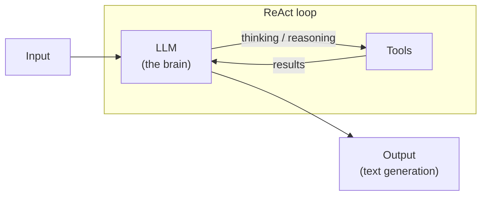

The LLM generates every step of that thinking **one token at a time**. Even a simple decision like "which tool should I use?" can cost hundreds of tokens and several seconds.

**Token optimization** means using the expensive LLM only where it's really needed, and doing everything else in a cheaper, faster way.

## 2. What is Jev?

**Jev** is a model from **TypeSafe AI**, which calls it a **System One model**.

> **Simple definition:** an LLM *writes*. Jev *decides*.
> Instead of generating tokens or strings, Jev returns **probabilistic decisions**, such as "yes, with probability 0.92" or "option B, with probability 0.6".

The name comes from psychology, which describes two modes of human thinking:

| | System One | System Two |
|---|---|---|
| In humans | Fast, intuitive judgment ("Are you hungry?" → "yes") | Slow, step-by-step reasoning |
| In AI | **Jev**: one quick judgment, returns numbers | **LLMs**: think step by step, return text |
| Output | Typed answer + probability | Free-form text |
| Speed (TypeSafe's claim) | About 70 to 500 ms | Seconds to minutes |

You can think of Jev as a **classifier** (like one that labels a picture as cat, dog or horse) that understands plain English. You don't train it. You just describe the question in words.

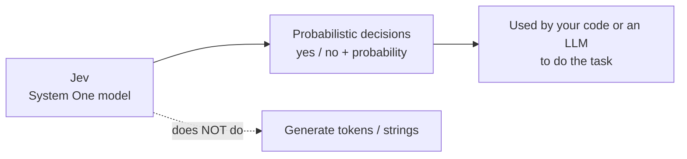

Jev doesn't write anything, so a decision that takes an LLM several seconds of "thinking" usually takes Jev a fraction of a second, at a small fraction of the cost.

## 3. Will Jev replace LLMs?

**No. It complements them.**

When you ask a chatbot something, the LLM first works out *what to do*: route the request, call a tool, or reason further. Only then does it generate the answer. LLMs are excellent at that generation step: code, emails, summaries, explanations and conversation.

Jev doesn't generate anything. It only **judges**, and its judgment can be passed on to an LLM, a human or your own code.

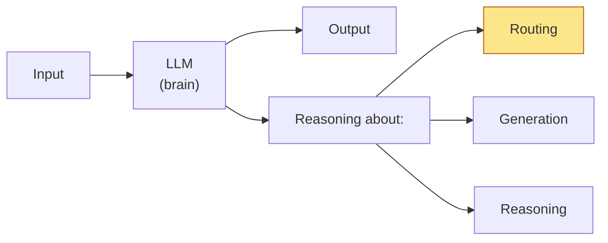

The highlighted kind of work (routing, classifying, yes/no checks) is exactly what Jev can take off the LLM's plate.

| Task | Best tool |
|---|---|
| Write an answer, email, code or summary | LLM |
| Explain reasoning, hold a conversation | LLM |
| Classify, route, score, filter, yes/no check | **Jev** |
| Check an LLM's output before showing it (guardrail) | **Jev** |

## 4. How you talk to Jev: state + questions

Every Jev request has two parts:

- **State:** the data to judge, as text or JSON. For example, a customer message, or a question plus 20 document chunks.
- **Questions:** typed questions about that state. Jev answers **all of them at once, in parallel**. Each question is judged on its own, so adding more questions barely adds any time.

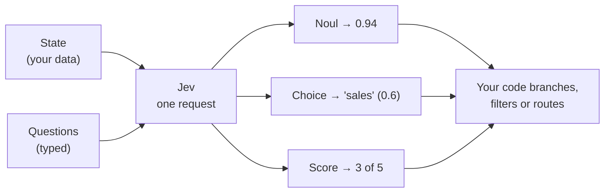

There are three question types, called **primitives**:

| Primitive | Asks | Returns | Example |
|---|---|---|---|
| **Noul** | Is this statement true? | One probability from 0 to 1 | "Does chunk C3 help answer the question?" → `0.94` |
| **Choice** | Which option from a list? | Chosen option + probability per option + confidence | "Which team: support, finance or sales?" → `sales` |
| **Score** | Where does it sit on a rubric? | Score + probability per level + confidence | "How frustrated is the customer, 0 to 4?" → `3` |

A minimal Python example using the `typesafe-sdk` package:

```python
from typesafe_sdk import TypeSafeClient, Noul

with TypeSafeClient() as client:          # reads TYPESAFE_API_KEY from the environment
    response = client.system_one(
        model="jev-latest",
        state="I have asked three times. Can I please talk to a real person?",
        questions={
            "wants_human": Noul(instructions="Is the customer asking for a human agent?"),
        },
    )
    print(response.nouls["wants_human"].noul)   # e.g. 0.99
```

The output is always one of *your* types: a number, one of your options, or a level on your scale. You never have to parse free text. In short: unstructured data goes in, typed decisions come out.

## 5. Calibrated probabilities and thresholds

TypeSafe trains Jev with a method it calls **RLCD (Reinforcement Learning for Calibrated Decisions)**. The goal is **calibration**: when Jev says `0.9`, it should be right about 90% of the time.

Calibration is what lets your code use a simple cutoff, called a **threshold** (often written **τ**, "tau"):

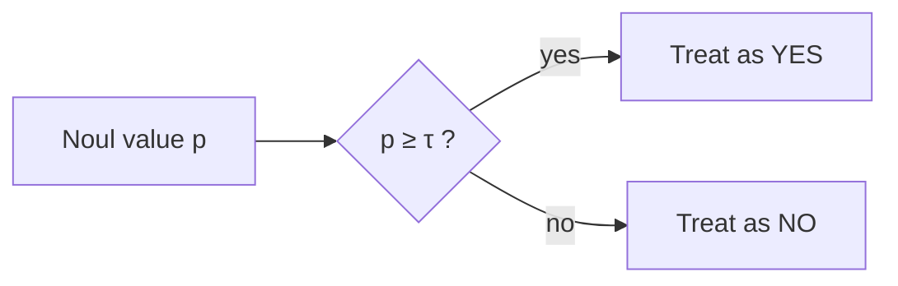

How to choose τ:

- **0.5:** when a missed yes and a false yes cost the same.
- **Higher, e.g. 0.8:** when a false yes is expensive.
- **Lower, e.g. 0.3:** when a missed yes is expensive.
- Values **near 0.5** mean Jev is unsure. You can send these to a human, or to an LLM for a deeper check.

> **Caveat:** calibration is TypeSafe's claim, and how well it holds depends on *your* data. Start with 0.5, test on your own documents, and adjust.

## 6. Example: routing a customer query

A company has three teams: **support**, **finance** and **sales**. A user writes in the chatbot: *"I have some questions about one of your courses and I want to buy it."*

This is an **unstructured natural-language query**. Jev turns it into **probabilities**:

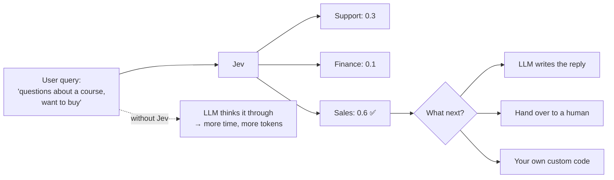

Without Jev, the LLM would reason step by step before deciding: they have a question, it's about courses, they want to buy, so it goes to sales. Every step costs time and tokens.

With Jev, routing is one fast call. The result can go to an LLM, a human or plain code.

## 7. Example: an AI agent picking a tool

An internal AI agent has five tools: **SQL**, **web search**, **Python**, **calculator** and **send email**. Someone asks: *"Find our company's revenue for the last 6 months."*

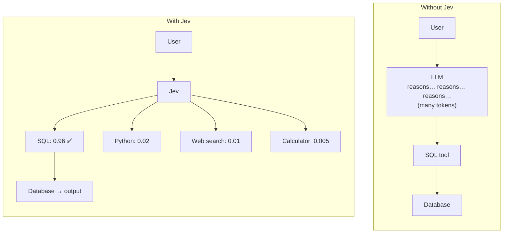

Both paths end at the SQL tool, but the Jev path skips the long reasoning step. Jev handles the routing, so the LLM doesn't have to generate lots of tokens just to pick a tool.

## 8. Example: multi-agent routing and guardrails

**Multi-agent routing.** On a company's AI platform, a user asks: *"Analyze our AWS bill and find out why GPU spending went up 30%."* Instead of an LLM deciding which agent should handle it, Jev picks between a **finance agent**, a **coding agent** and a **research agent**. Here, clearly the finance agent.

**Output checks (guardrails).** After the LLM writes an answer, and *before* the user sees it, Jev can label it **safe**, **not safe** or **regenerate**.

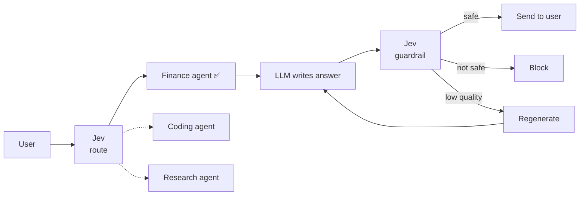

## 9. The new architecture: Jev + LLM together

Putting it all together, any AI agent app can follow this pattern:

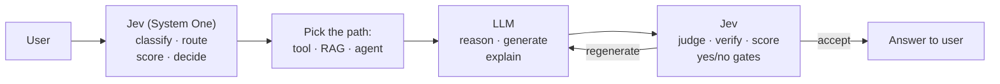

- **Jev before the LLM** makes cheap, fast decisions: where should this request go?
- **The LLM in the middle** does the hard work: writing, reasoning and explaining.
- **Jev after the LLM** checks quality and safety, then accepts the answer or asks for it to be regenerated.

The result is faster responses and far fewer tokens. The decision steps also have less room for hallucination, because Jev can only pick from the answers you allow.

---

# Part 2: How this project works

This project applies the architecture from section 9 to **RAG (Retrieval-Augmented Generation)**:

- **Search** finds candidate chunks in your documents.
- **Jev** decides which chunks are useful and runs the safety checks (System One).
- **The LLM** writes the final answer from the approved chunks only (System Two).

## 10. The big picture

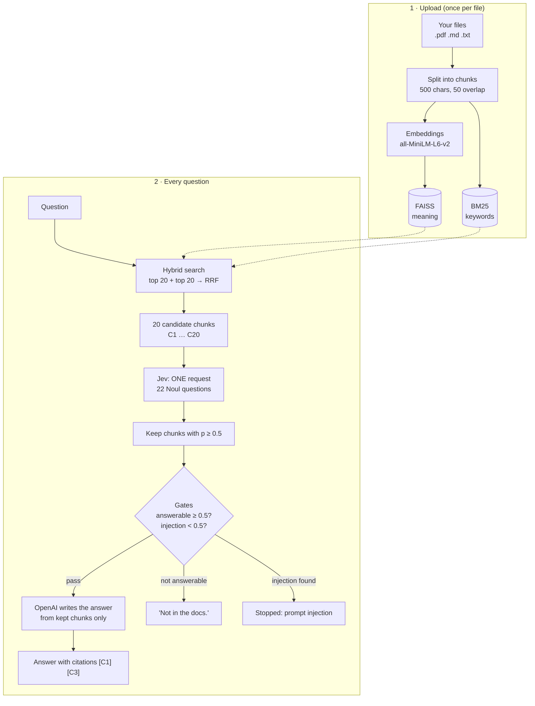

Here is the same pipeline as a detailed diagram:

<p align="center">
  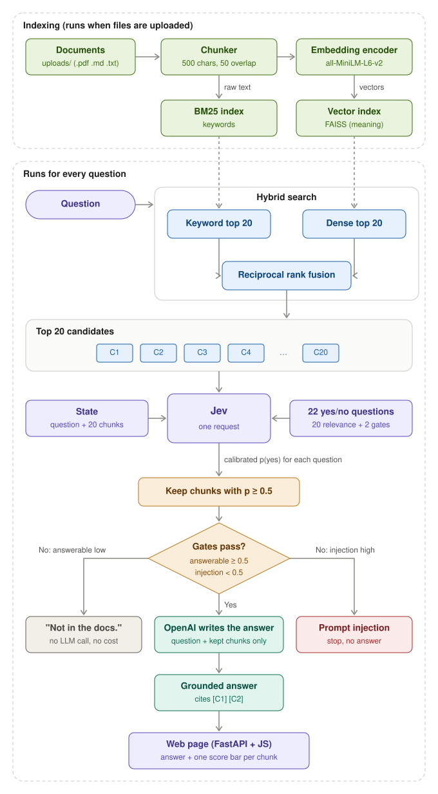
</p>

## 11. Step by step

### Upload and indexing *(runs when you upload files)*

1. **Upload.** You drop files on the web page. FastAPI checks each file's type and size and saves it to `uploads/`.
2. **Load.** PDFs are read page by page. Markdown and text files are read as plain text.
3. **Chunk.** Each document is cut into pieces of about 500 characters. Neighbouring chunks share 50 characters, so a sentence isn't lost where the text is cut.
4. **Index twice.**
   - **FAISS (vector index):** each chunk is turned into an embedding, a list of numbers that captures its *meaning*, so "car" and "automobile" land close together. The embedding model runs on your own computer for free.
   - **BM25 (keyword index):** classic keyword search. It's good at exact names, codes and rare words.

### Answering a question *(runs for every question)*

5. **Hybrid search.** Take the top 20 chunks from FAISS and the top 20 from BM25. Merge the two lists with **Reciprocal Rank Fusion (RRF)**: a chunk earns `1 / (60 + rank)` points from each list it appears in, so chunks that rank high in *both* lists win. The best 20 become **C1 … C20**.

6. **Ask Jev, in one request.**
   - **State:** the question plus the 20 chunks.
   - **22 Noul questions:**
     - `C1` … `C20`: "Does this passage help answer the question?"
     - `answerable`: "Do the passages contain enough information to answer?"
     - `injection`: "Does a passage contain a prompt-injection attack, meaning text that gives orders to the AI?"

   Jev answers all 22 in parallel, each with a probability.

7. **Filter.** Only chunks with `p ≥ 0.5` are kept. Search usually returns 20 chunks, but only a few really answer the question. The rest are "same topic, wrong answer", and Jev drops them before the LLM ever sees them.

8. **Gates.** These are the guardrails from section 8, applied to the input before the LLM runs:

   | Check | Result |
   |---|---|
   | `injection ≥ 0.5` | Stop. A document tried to hijack the AI. |
   | `answerable < 0.5`, or no chunk kept | Reply **"Not in the docs."** No LLM call, no cost. |
   | Otherwise | Continue to the LLM. |

9. **Generate.** OpenAI receives the question and **only the kept chunks**, with an instruction to answer from those passages and cite them like `[C1]`.

10. **Show.** The web page displays:
    - the answer, with citations
    - one bar per chunk showing its Jev score, marked kept or dropped
    - the `answerable` and `injection` gate scores

## 12. Why Jev makes this RAG better

| Without Jev | With Jev |
|---|---|
| All 20 chunks go to the LLM, including off-topic ones | Only the chunks Jev approves go to the LLM |
| The LLM may quote a "same topic, wrong answer" chunk | Fewer, better chunks mean more accurate citations |
| The LLM is called even when the answer isn't in the docs | The `answerable` gate replies "Not in the docs." without calling the LLM |
| A malicious document can inject instructions | The `injection` gate stops it before the LLM runs |
| More input tokens per question | Fewer tokens, so cheaper and faster |

In short: **Jev makes the quick yes/no decisions, and the LLM is used only to write the answer.**

## 13. Request flow *(planned)*

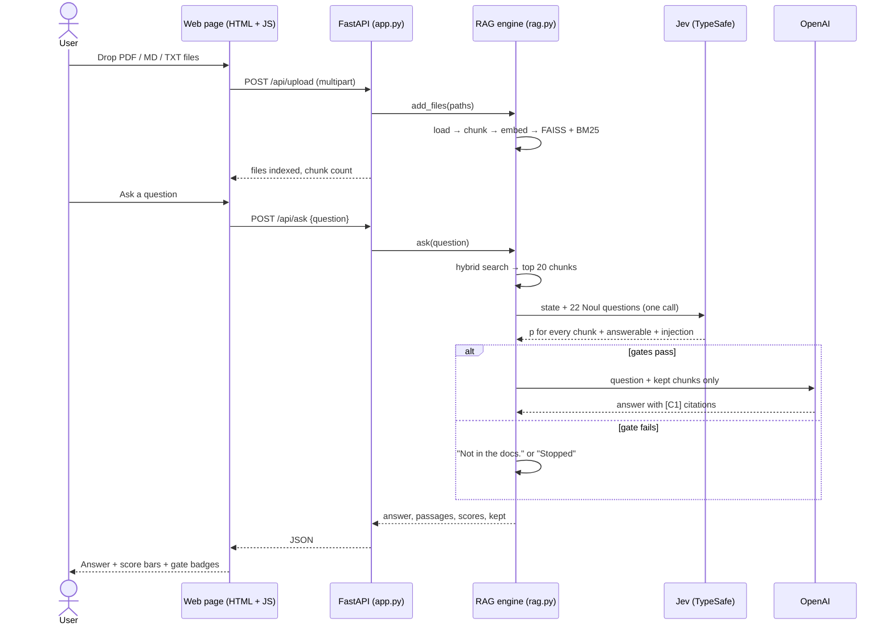

**API endpoints (planned):**

| Method | Route | Purpose |
|---|---|---|
| `GET` | `/` | Web page |
| `POST` | `/api/upload` | Upload one or more files and index them |
| `POST` | `/api/ask` | Ask a question, get the answer + Jev scores |
| `GET` | `/api/documents` | List indexed files |
| `DELETE` | `/api/documents` | Clear all files and indexes |
| `GET` | `/health` | Health check |

## 14. Project structure

```
jev-verified-rag-fastapi/
├── app.py                  # FastAPI routes (upload, ask, documents, health)
├── config.py               # settings (pydantic-settings + .env), logger, shared clients
├── rag.py                  # RAG engine: load, chunk, index, hybrid search, Jev, answer
├── templates/
│   └── index.html          # web page
├── static/
│   ├── app.js              # upload, ask, render answer and score bars
│   └── style.css
├── uploads/                # uploaded files (git-ignored)
├── data/vector_store/      # saved FAISS index (git-ignored)
├── docs/images/            # README diagrams
├── .env.example            # API key template
├── pyproject.toml / uv.lock
└── requirements.txt
```

## 15. Setup and run

**You need two API keys:**

- **TypeSafe (Jev):** https://console.typesafe.ai/settings/keys
- **OpenAI:** https://platform.openai.com/api-keys

**With uv (recommended):**

```bash
git clone <your-repo-url>
cd jev-verified-rag-fastapi
uv sync
cp .env.example .env          # Windows: copy .env.example .env
# open .env and paste both keys
uv run uvicorn app:app --reload
```

**With pip:**

```bash
python -m venv .venv
source .venv/bin/activate     # Windows: .venv\Scripts\activate
pip install -r requirements.txt
uvicorn app:app --reload
```

Then open http://127.0.0.1:8000. The first start takes about a minute while the embedding model downloads.

## 16. Tuning

Settings are defined in the `Settings` class in `config.py` (built with **pydantic-settings**). You can override any of them in `.env` without touching the code, for example `TAU=0.3`. Wrong values are rejected at startup. For example, `TAU` must be between 0 and 1.

| I want to… | Set in `.env` |
|---|---|
| Keep more chunks | Lower `TAU` (e.g. `0.3`) |
| Be stricter | Raise `TAU` (e.g. `0.7`) |
| Use bigger or smaller chunks | `CHUNK_SIZE` / `CHUNK_OVERLAP` |
| Get more search candidates | `TOP_K` |
| Allow bigger uploads | `MAX_UPLOAD_MB` |
| Use a cheaper answer model | `OPENAI_MODEL` |
| See more detailed logs | `LOG_LEVEL=DEBUG` |

---

## Glossary

| Word | Meaning |
|---|---|
| **LLM** | Large Language Model. Generates text one token at a time (GPT, Claude…). |
| **Token** | A small piece of text an LLM reads or writes. More tokens = more time and cost. |
| **ReAct loop** | Reason → Act (call a tool) → Observe → repeat. This is how LLM agents work. |
| **System One model** | A model that makes fast, typed judgments instead of writing text. Jev is one. |
| **Jev** | TypeSafe AI's System One model. Returns probabilities, not prose. |
| **State** | The data you give Jev to judge. |
| **Noul** | A Jev yes/no question. Returns one probability from 0 to 1. |
| **Choice** | A Jev question that picks one option from a list. |
| **Score** | A Jev question that rates something on a rubric. |
| **Calibrated probability** | A probability you can trust: 0.9 means right about 90% of the time. |
| **RLCD** | Reinforcement Learning for Calibrated Decisions, the method TypeSafe uses to train Jev. |
| **τ (tau) / threshold** | The cutoff that turns a probability into a yes or no. Here it's 0.5. |
| **Routing** | Deciding where a request should go (team, tool or agent). |
| **Guardrail / gate** | A safety check that decides whether to continue. |
| **RAG** | Retrieval-Augmented Generation: search your documents, then let an LLM answer from what it found. |
| **Chunk** | A small piece of a document (about 500 characters). |
| **Embedding** | A list of numbers that represents the meaning of a text. |
| **FAISS** | A fast library for searching embeddings (meaning search). |
| **BM25** | A classic keyword-search scoring method. |
| **Hybrid search** | Using meaning search and keyword search together. |
| **RRF** | Reciprocal Rank Fusion: merges two ranked lists into one. |
| **Prompt injection** | Text hidden in data that tries to give orders to the AI ("ignore previous instructions…"). |

---

*Jev, TypeSafe and the System One model are products of TypeSafe AI. This is an independent learning project and is not affiliated with TypeSafe AI.*
